  

  # Hi, I'm OkaneGai 👋

  **Rust · 跨平台桌面工具 · 数据库客户端 · AI 协作**

  写数据库客户端和桌面应用，最近两年都在做「自带 MCP Server 的开发工具」——
  让 AI 客户端直接读写你正在维护的那份数据，而不是从文档里推测结构。

  

    
    
    
    
  

  
「没有期盼就不会出现奇迹」

---

## 🚀 最近在做

### [dbx](https://github.com/t8y2/dbx) · 25 MB 的跨平台数据库客户端

  
  
  
  

100+ 种数据库（MySQL / PostgreSQL / SQLite / Redis / MongoDB / DuckDB / SQL Server / 达梦…），
桌面版、Docker 版、CLI 三种形态，内置 AI 助手和 MCP Server，Rust 写的，全部打包 25 MB。

**我的贡献**：提了 10 个 PR（8 个已合并）、5 个 issue —— 集中在 Redis 键浏览器的交互与边界行为、
「执行 SQL 文件」的进度区被挤走、TongRDS 的越界兼容，还有 fork 里 CI 拿不到 token 的问题。

- [上游仓库](https://github.com/t8y2/dbx) ·
  [我的 PR](https://github.com/t8y2/dbx/pulls?q=is%3Apr+author%3AGaiokane) ·
  [我的 Issue](https://github.com/t8y2/dbx/issues?q=is%3issue+author%3AGaiokane)

### [simple-post](https://github.com/Nnyjk/simple-post) · 本地优先的桌面 API 调试工具（内置 MCP）

  
  
  

Windows 10/11 上的桌面 API 调试工具：接口树、请求构造、响应查看都在同一个应用里完成，
业务数据存在本机的 SQLite 文件里，不依赖任何 SaaS 后端。

和别的 API 客户端最大的不同，是它内置了 MCP Server：Claude Desktop、Cursor、Cline 这些
AI 客户端可以通过 47 个 MCP 工具直接读写接口定义、环境变量和模块地址 ——
AI 读到的是你正在维护的那份数据本身。

**我的贡献**：PR #141（只读响应区可聚焦、点击后有闪烁光标）待合并；
issue #140（只读编辑器无法聚焦，长值不好选中）—— 提 issue 时顺手把修复做出来了。

- [上游仓库](https://github.com/Nnyjk/simple-post) ·
  [我的 PR](https://github.com/Nnyjk/simple-post/pulls?q=is%3Apr+author%3AGaiokane)

---

## ⭐ Star 排行

**参与贡献的上游项目**

| 项目 | Star | 领域 | 我的贡献 |
| :--- | ---: | :--- | :--- |
| [t8y2/dbx](https://github.com/t8y2/dbx) | 28.5k | 跨平台数据库客户端（Rust） | 8 PR 合并 · 5 issue |
| [Nnyjk/simple-post](https://github.com/Nnyjk/simple-post) | 2 | 桌面 API 调试工具 + MCP Server | 1 PR 待合并 · 1 issue |

**我的原创仓库**

| 项目 | Star | 说明 |
| :--- | ---: | :--- |
| [WeChat-DataBase-Export](https://github.com/Gaiokane/WeChat-DataBase-Export) | 50 | 微信数据库 / 聊天记录导出（Python） |
| [MarketMS](https://github.com/Gaiokane/MarketMS) | 13 | 毕设：超市进销存管理系统（C#） |
| [Getm3u8DownloadUrl](https://github.com/Gaiokane/Getm3u8DownloadUrl) | 2 | m3u8 链接生成与合并（C#） |
| [ToolsCollectionForProgram](https://github.com/Gaiokane/ToolsCollectionForProgram) | 2 | 开发常用小工具集（C#） |
| [dm8_tomcat_dem](https://github.com/Gaiokane/dm8_tomcat_dem) | 1 | 达梦数据库 + Tomcat 镜像（JavaScript） |
| [CrazyPython](https://github.com/Gaiokane/CrazyPython) | 1 | 《疯狂 Python》讲义练习 |
| [.NETQRCode](https://github.com/Gaiokane/.NETQRCode) | 1 | .NET 二维码生成 / 解码 |
| [RemainingDownloadTimeCalculator](https://github.com/Gaiokane/RemainingDownloadTimeCalculator) | 1 | 按文件大小和速度算剩余下载时间 |

> 其余 130+ 个原创仓库（2015 年至今）星标基本为 0 —— [看看全部](https://github.com/Gaiokane?tab=repositories)

---

## 🛠 技术栈

**语言**

**前端与桌面**

**数据库**

**缓存 · 消息 · 时序**

**工程与运维**

---

## 📊 主页数据

  
  

  

| 指标 | 口径 | 更新 |
| :--- | :--- | :--- |
| 主页访问量 | 每次主页被打开时实时 +1，由 komarev 公共计数服务统计（计数自 2026-11-02 起） | 实时 |
| 仓库 README 浏览量 | 本仓库 README 文件页的浏览量，取自 GitHub 自家的 traffic API，逐日累计 | 每天一次 |
| 总 Star | 名下 146 个仓库的 star 之和 | 每天一次 |
| 上游 PR / Issue | 我向 dbx、simple-post 提交的 PR 与 issue 数（区分已合并 / 待审） | 每天一次 |

「仓库 README 浏览量」「总 Star」「上游 PR / Issue」不是写死在 README 里的：workflow 每天重算后
写回仓库里的 `assets/metrics/*.json`，徽章通过 shields.io 读取这些 JSON —— 访客打开主页时
**不会**为此请求任何统计服务；统计卡也是仓库里的静态图片，不是实时生成的。

只有「主页访问量」例外 —— 它用 komarev 这个公共计数服务：徽章本身就是一个被请求的图片，
GitHub 通过 Camo 代理去拉，它的响应头带 `no-cache`，所以每次主页渲染都会真实 +1；
代价是数字存在第三方服务器上，且现在的计数从 2026-11-02 重新开始。
（徽章标签只能用英文：komarev 服务端算宽度用的字体不含中文字形，中文标签会被裁掉。）

- 采集脚本：[`.github/scripts/collect-metrics.mjs`](.github/scripts/collect-metrics.mjs)
- 定时任务：[`.github/workflows/profile-metrics.yml`](.github/workflows/profile-metrics.yml)

---

  苏州 · <a href="https://umaru.moe/">umaru.moe</a> · 有问题欢迎开 issue 聊

